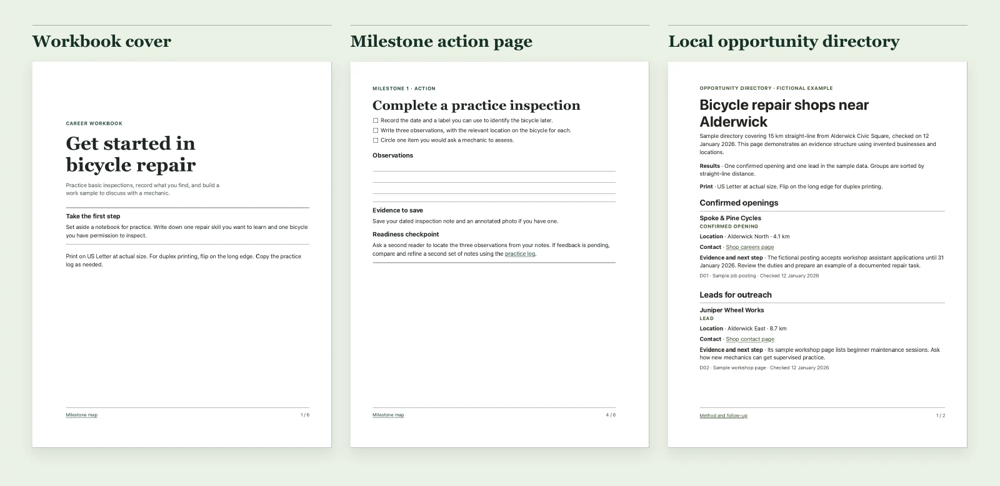

# 

Build a career workbook someone can print, write in, and work through. Research the shops, employers, or training providers they can contact next.

Two independently installable [Agent Skills](https://agentskills.io/specification) for career changers and the people guiding them. Use either skill on its own, or pair a workbook with a local directory.

## Quick start

```sh
npx skills add alexiseverage/career-guide-skills
```

Choose a skill and your agent in the [skills CLI](https://skills.sh/docs/cli). Installation has been checked with Codex and Claude Code. While the repository is private, use an account with access.

After installation, ask your agent for the guide you want.

> Build a 24-page A4 workbook for someone moving into bookkeeping. Include practice tasks, a skills checklist, and a weekly study plan.

## See the output

[](docs/assets/print-preview.webp)

The preview uses the bundled [workbook template](skills/career-guide-book/assets/workbook.html) and [directory template](skills/local-opportunity-directory/assets/directory.html), with fictional sample listings.

## Choose a skill

### Career guide book

Use [`career-guide-book`](skills/career-guide-book/SKILL.md) for a self-paced workbook. It defaults to **50 pages**, including the cover, worksheets, and references. Request a shorter or longer edition in your prompt.

Each milestone pairs instruction with an action, something to save, and a checkpoint to help the reader decide whether to advance. Reusable worksheets leave room to write and can be photocopied on their own.

### Local opportunity directory

Use [`local-opportunity-directory`](skills/local-opportunity-directory/SKILL.md) to research employers, studios, shops, mentors, and training providers in a named area or within a radius. Listings distinguish outreach leads from confirmed openings and include public contact routes, dated evidence, and a suggested next step.

> Find bicycle repair shops within 20 km of Edinburgh city centre where I could ask about work experience. Include public contacts and label confirmed openings.

## Designed for paper

Both skills default to a **print-ready PDF and editable HTML**. They use Letter or A4 for the intended print locale, with US Letter as the fallback. Low-ink pages, duplex binding margins, clear page numbers, and writing space make the result practical on a home printer.

Name a visual style in your prompt to opt in. With [Aesthetic Frontend Skills](https://github.com/alexiseverage/aesthetic-frontend-skills), the guide can translate a style like Art Deco into type, accents, and simple motifs that still read well in grayscale.

## Compatibility and development

- **Manual install.** Copy the complete folder for the skill you want from [`skills/`](skills/) to your agent's skill directory. To install with the CLI from a checkout, run `npx skills add .` from its root.
- **Agent capabilities.** Current research uses web access or supplied sources. PDF export needs a document or browser renderer. The workflow can provide editable source or a research worksheet when those tools are unavailable.
- **Contributing.** Start with the [smoke tests](tests/README.md), [glossary](GLOSSARY.md), and [packaging decision](docs/adr/0001-standalone-skills.md). Keep examples fictional and exclude personal documents and machine-specific configuration.

[MIT License](LICENSE)
